<picture>
  <source media="(prefers-color-scheme: dark)" srcset="assets/header-dark.svg">
  
</picture>

  <picture>
    <source media="(prefers-color-scheme: dark)" srcset="assets/tag-now-dark.svg">
    
  </picture>
  &nbsp;Building <a href="https://github.com/HamdanEsmail/keepers-lantern">Keeper's Lantern</a>, a browser survival game, for Hack Club Terra week 1. <a href="https://hamdanesmail.github.io/keepers-lantern/">Play it</a>.

<a href="https://hamdanesmail.github.io/dubai-property-prices/">
  <picture>
    <source media="(prefers-color-scheme: dark)" srcset="assets/featured-dark.svg">
    
  </picture>
</a>

  <a href="https://hamdanesmail.github.io/dubai-property-prices/">Open the explorer</a> &nbsp;·&nbsp;
  <a href="https://github.com/HamdanEsmail/dubai-property-prices">Repository</a> &nbsp;·&nbsp;
  <a href="https://github.com/HamdanEsmail/dubai-property-prices/blob/main/docs/data.md">How the data was cleaned</a>

<table>
  <tr>
    <td width="50%" valign="top">
      <a href="https://hamdanesmail.github.io/keepers-lantern/">
        <picture>
          <source media="(prefers-color-scheme: dark)" srcset="assets/project-keepers-lantern-dark.svg">
          
        </picture>
      </a>
      
<a href="https://hamdanesmail.github.io/keepers-lantern/">Play in the browser</a> &nbsp;·&nbsp; <a href="https://github.com/HamdanEsmail/keepers-lantern">Repo</a>

    </td>
    <td width="50%" valign="top">
      <a href="https://firstrole.hamdanesmail12-7a9.workers.dev">
        <picture>
          <source media="(prefers-color-scheme: dark)" srcset="assets/project-firstrole-dark.svg">
          
        </picture>
      </a>
      
<a href="https://firstrole.hamdanesmail12-7a9.workers.dev">Live demo</a> &nbsp;·&nbsp; <a href="https://github.com/HamdanEsmail/firstrole">Repo</a>

    </td>
  </tr>
  <tr>
    <td width="50%" valign="top">
      <a href="https://coursesignal-bzb.pages.dev/">
        <picture>
          <source media="(prefers-color-scheme: dark)" srcset="assets/project-coursesignal-dark.svg">
          
        </picture>
      </a>
      
<a href="https://coursesignal-bzb.pages.dev/">Companion site</a> &nbsp;·&nbsp; <a href="https://github.com/HamdanEsmail/coursesignal">Repo</a>

    </td>
    <td width="50%" valign="top">
      <a href="https://hamdanesmail.github.io/study-sprint/">
        <picture>
          <source media="(prefers-color-scheme: dark)" srcset="assets/project-study-sprint-dark.svg">
          
        </picture>
      </a>
      
<a href="https://hamdanesmail.github.io/study-sprint/">Try it</a> &nbsp;·&nbsp; <a href="https://github.com/HamdanEsmail/study-sprint">Repo</a>

    </td>
  </tr>
</table>

  
More

  <ul>
    <li><a href="https://github.com/HamdanEsmail/borrowed-alibi">Borrowed Alibi</a>: an android investigation thriller you play in the browser. Prologue playable.</li>
    <li><a href="https://github.com/HamdanEsmail/Windows-95-in-a-Browser">Windows 95 in a Browser</a>: the classic desktop and file manager, with sounds generated by the Web Audio API.</li>
    <li><a href="https://hamdanesmail.github.io/ChemistryProject.github.io/">Chemistry Project</a>: a learning site with quizzes and interactive simulations.</li>
  </ul>

<picture>
  <source media="(prefers-color-scheme: dark)" srcset="assets/toolkit-dark.svg">
  
</picture>

  <picture>
    <source media="(prefers-color-scheme: dark)" srcset="assets/tag-education-dark.svg">
    
  </picture>
  &nbsp;<strong>United Arab Emirates University</strong>, B.Sc. in Data Science and Artificial Intelligence, undergraduate.

  <picture>
    <source media="(prefers-color-scheme: dark)" srcset="assets/tag-contact-dark.svg">
    
  </picture>
  &nbsp;I like talking with people who build with data.

<a href="https://github.com/HamdanEsmail">
  <picture>
    <source media="(prefers-color-scheme: dark)" srcset="assets/hello-dark.svg">
    
  </picture>
</a>

<!-- EMAIL: replace the line below with the address once it is decided -->

Email: coming soon &nbsp;·&nbsp; GitHub: <a href="https://github.com/HamdanEsmail">@HamdanEsmail</a>

