

Read the About part as plain text

<b>I'm Hamdan.</b> I study data science and AI at United Arab Emirates University, and I like software that is finished: it has a live address, it works on a phone, and you can try it without asking me first.

Most of what I make checks a claim against its source: a register, a price page, a permit office, my own university portal. When a tool of mine can't prove something, it says so and leaves the gap open. I would rather show a blank than a guess.

<b>Studying</b> B.Sc. in Data Science and Artificial Intelligence, United Arab Emirates University 
<b>Based</b> United Arab Emirates &nbsp;·&nbsp; <b>Speaks</b> Arabic and English 
<b>Works in</b> TypeScript, Python, Dart, Cloudflare Workers, Phaser

<h3>How I got here</h3>

<b>2020</b> &nbsp;I looked after the computers at my father's business, for a staff of ten. I was the whole IT department. 
<b>2025</b> &nbsp;First place at the AUS High School Computing Competition with Digital EcoHome, a smart-home app that read eleven Arduino sensors. 
<b>2025</b> &nbsp;Finished school at the top of my class, and started Data Science and AI at UAEU. 
<b>2026</b> &nbsp;Two browser games for Hack Club Terra, a price model from 109,706 Dubai property sales, then nine builds in seventeen days for one TinyFish bounty round.

<h3>The nine worlds</h3>

<a href="https://falaj.falaj.workers.dev/"></a><a
  href="https://backed.hamdanesmail12-7a9.workers.dev/"></a><a
  href="https://standing.hamdanesmail12-7a9.workers.dev/"></a><a
  href="https://fineprint.hamdanesmail12-7a9.workers.dev/"></a><a
  href="https://redtape.hamdanesmail12-7a9.workers.dev/"></a><a
  href="https://groundwork.hamdanesmail12-7a9.workers.dev/"></a><a
  href="https://upstream.hamdanesmail12-7a9.workers.dev/"></a><a
  href="https://knock.hamdanesmail12-7a9.workers.dev/"></a><a
  href="https://takehome.hamdanesmail12-7a9.workers.dev/"></a>

The nine worlds as plain text, with links to the code

<ul>
<li><b>Falaj.</b> UAEU's public website as ten MCP tools, read live with TinyFish. <a href="https://falaj.falaj.workers.dev/">Open it</a> &nbsp;·&nbsp; <a href="https://github.com/HamdanEsmail/falaj">Code</a></li>
<li><b>Backed.</b> Who funded companies like yours, with the proof. <a href="https://backed.hamdanesmail12-7a9.workers.dev/">Open it</a> &nbsp;·&nbsp; <a href="https://github.com/HamdanEsmail/backed">Code</a></li>
<li><b>Standing.</b> What the official register says about a person or a business, right now, with the proof. <a href="https://standing.hamdanesmail12-7a9.workers.dev/">Open it</a> &nbsp;·&nbsp; <a href="https://github.com/HamdanEsmail/standing">Code</a></li>
<li><b>Fineprint.</b> A dated record of the web's small print: pricing pages, terms, policies and fee tables. <a href="https://fineprint.hamdanesmail12-7a9.workers.dev/">Open it</a> &nbsp;·&nbsp; <a href="https://github.com/HamdanEsmail/fineprint">Code</a></li>
<li><b>Redtape.</b> Every licence, permit and filing to start one activity in three places, each fee proved on its official page or left open. <a href="https://redtape.hamdanesmail12-7a9.workers.dev/">Open it</a> &nbsp;·&nbsp; <a href="https://github.com/HamdanEsmail/redtape">Code</a></li>
<li><b>Groundwork.</b> Nine public records on one Philadelphia address, each linked to its source. <a href="https://groundwork.hamdanesmail12-7a9.workers.dev/">Open it</a> &nbsp;·&nbsp; <a href="https://github.com/HamdanEsmail/groundwork">Code</a></li>
<li><b>Upstream.</b> Highlight a claim on any page and follow it back to where it first appeared. <a href="https://upstream.hamdanesmail12-7a9.workers.dev/">Open it</a> &nbsp;·&nbsp; <a href="https://github.com/HamdanEsmail/upstream">Code</a></li>
<li><b>Knock.</b> Hand in a spreadsheet of companies and get it back with a verdict on every row, the day each was last seen and links to the evidence. <a href="https://knock.hamdanesmail12-7a9.workers.dev/">Open it</a> &nbsp;·&nbsp; <a href="https://github.com/HamdanEsmail/knock">Code</a></li>
<li><b>Takehome.</b> Take everything out of a student portal that has no export button. <a href="https://takehome.hamdanesmail12-7a9.workers.dev/">Open it</a> &nbsp;·&nbsp; <a href="https://github.com/HamdanEsmail/takehome">Code</a></li>
</ul>

<h3>Also made</h3>

<ul>
<li><a href="https://hamdanesmail.github.io/dubai-property-prices/">Dubai property prices</a>: what flats and villas sell for per square metre in each Dubai community, from 109,706 cleaned sales.</li>
<li><a href="https://hamdanesmail.github.io/keepers-lantern/">Keeper's Lantern</a>: a survival game about a lantern and a forest that moves every night.</li>
<li><a href="https://github.com/HamdanEsmail/borrowed-alibi">Borrowed Alibi</a>: an android investigation thriller you play in the browser.</li>
<li><a href="https://firstrole.hamdanesmail12-7a9.workers.dev">FirstRole</a>, <a href="https://coursesignal-bzb.pages.dev/">CourseSignal</a> and <a href="https://hamdanesmail.github.io/study-sprint/">Study Sprint</a>: three tools for students.</li>
</ul>

<a href="https://github.com/HamdanEsmail">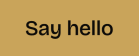</a>

