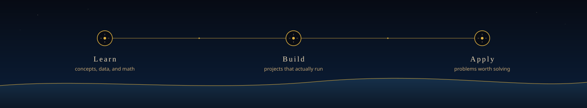

  <picture>
    <source media="(prefers-reduced-motion: reduce)" srcset="./assets/profile-header-static.svg">
    
  </picture>

  
<strong>Learning with curiosity · Building with purpose · Sharing the journey</strong>

  

    
    
    
  

I am a Data Science and Artificial Intelligence undergraduate at **United Arab Emirates University**. I use data, code, and careful questions to understand real problems and turn them into working software.

I learn best by building—coursework, independent study, and public projects. I am looking for internships, research, and collaborations with other students.

  

### Tools in rotation

  
  
  
  
  
  

## Featured work

<table>
  <tr>
    <td width="50%" valign="top">
      <h3><a href="https://github.com/HamdanEsmail/firstrole">FirstRole</a></h3>
      
      
A student job finder that reads public careers pages and turns them into a shortlist with sources, match reasons, and freshness—not invented openings.

      
<strong>TypeScript · Cloudflare Workers · TinyFish</strong>

      
<a href="https://firstrole.hamdanesmail12-7a9.workers.dev">Live demo</a>

    </td>
    <td width="50%" valign="top">
      <h3><a href="https://github.com/HamdanEsmail/coursesignal">CourseSignal</a></h3>
      
      
An evidence-first student copilot in iMessage. It finds and reads live public sources, then replies with a short, receipt-backed answer.

      
<strong>TypeScript · TinyFish · iMessage</strong>

      
<a href="https://coursesignal-bzb.pages.dev/">Live companion</a>

    </td>
  </tr>
</table>

## Education

**United Arab Emirates University (UAEU)**  
B.Sc. in Data Science and Artificial Intelligence  
Undergraduate · United Arab Emirates

## GitHub activity

  <picture>
    <source media="(prefers-color-scheme: dark)" srcset="https://github-readme-stats.vercel.app/api?username=HamdanEsmail&show_icons=true&hide_border=false&bg_color=00000000&title_color=E3B341&text_color=E8D5B5&icon_color=C4A574&border_color=E3B341&rank_icon=github">
    
  </picture>
  <picture>
    <source media="(prefers-color-scheme: dark)" srcset="https://github-readme-stats.vercel.app/api/top-langs/?username=HamdanEsmail&layout=compact&hide_border=false&bg_color=00000000&title_color=E3B341&text_color=E8D5B5&border_color=C4A574">
    
  </picture>

Language statistics reflect public repository usage and do not indicate proficiency.

## Connect

I like meeting students, researchers, and people building with data and AI.

  
  

<strong>Always learning. Always building.</strong>

