  

  

  
  
  

I am a Data Science and Artificial Intelligence undergraduate at **United Arab Emirates University**. I use data, code, and careful questions to understand real problems and turn them into working software.

I learn best by building: coursework, independent study, and public projects. My flagship right now is a story-driven browser game. I am looking for internships, research, and collaborations with other students.

## Flagship

  

> *Two androids confess to the same murder. Their recordings are genuine. Their accounts cannot both be right.*

You play **Echo**, an android who reconstructs what witnesses saw, aboard a retired passenger liner turned neighbourhood. Inspect the scene, question people, lay a recorded memory over the real room, and decide what goes on record. Choices carry forward from chapter to chapter, and a new chapter ships every week (built for [Hack Club](https://hackclub.com/) Terra).

  

## Field work

<table>
  <tr>
    <td width="50%" valign="top">
      
      
<a href="https://github.com/HamdanEsmail/borrowed-alibi">Repository</a>

    </td>
    <td width="50%" valign="top">
      
      
<a href="https://github.com/HamdanEsmail/firstrole">Repository</a> · <a href="https://firstrole.hamdanesmail12-7a9.workers.dev">Live demo</a>

    </td>
  </tr>
  <tr>
    <td width="50%" valign="top">
      
      
<a href="https://github.com/HamdanEsmail/coursesignal">Repository</a> · <a href="https://coursesignal-bzb.pages.dev/">Live companion</a>

    </td>
    <td width="50%" valign="top">
      
      
<a href="https://github.com/HamdanEsmail/study-sprint">Repository</a>

    </td>
  </tr>
</table>

  

## Loadout

  
  
  
  
  
  
  
  
  

## Education

**United Arab Emirates University (UAEU)**  
B.Sc. in Data Science and Artificial Intelligence  
Undergraduate · United Arab Emirates

## Activity

  
  

## Contact

I like meeting students, researchers, and people building with data and AI.

  
  

<strong>Always learning. Always building.</strong>

